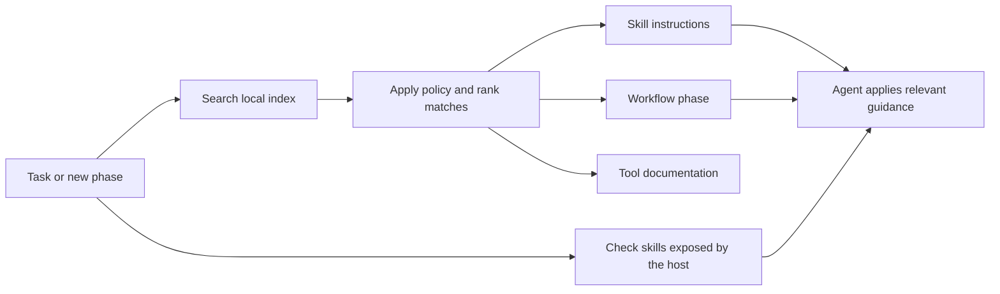

# Skills Orchestrator

[](https://github.com/JAlvarado-exe/skills-orchestrator/actions/workflows/ci.yml)  [](LICENSE)

Keep hundreds of agent skills on disk. Give your agent the few instructions that fit the task in front of it.

A code review, a pricing decision and a field interview can happen in the same project. Each needs different guidance. Skills Orchestrator searches your installed skills, cloned libraries and registered methodology guides at each change of task. The result names the matching terms and the file to open. The agent can leave the rest of the library on disk.

**Python standard library · Offline at runtime · Works from a checkout · MIT**

## Try a real workflow

Clone the repository and run these commands from its root with Python 3.9 or newer. The example ships with the repository and uses its own local registry.

```sh
git clone https://github.com/JAlvarado-exe/skills-orchestrator.git
cd skills-orchestrator
python -m orchestrator find "plan field interviews" --config examples/field-study/config.json
python -m orchestrator workflow workflow/field-study --config examples/field-study/config.json
python -m orchestrator workflow workflow/field-study --done observe --config examples/field-study/config.json
```

The search returns **WORKFLOW** and a local overview. The first phase command returns the observation guide. Once observations are complete, the last command shows that review requires the owner's approval. The caller supplies the completed phases on each invocation. [Explore the example](examples/field-study/guide/workflow.json) · [Register your own guide](docs/WORKFLOWS.md)

## How an agent uses the library



| When you need to... | Use | What you get |
| --- | --- | --- |
| Locate instructions in a large collection | `find` | Ranked candidates, matched terms, selected copy and local path. An empty result prompts a broader search. |
| Connect a cold library or a team folder | `scan` | A local index of skill metadata and file origins. Exact copies share an entry. |
| Work in another language | `find --also` | Search original terms alongside translations and paraphrases. The offline vocabulary covers selected concepts across 12 tested languages. |
| Choose between competing approaches | `conflicts` | Curated guidance on composing skills, choosing by project context and actions that need owner approval. |
| Resume a methodology | `workflow` | Eligible phases, missing prerequisites and explicit approval requirements. |
| Review a downloaded skill | `vet` | A static report on instruction files, hooks, installers and scan coverage. |
| Diagnose a collection | `list`, `doctor`, `overlaps` | Inventory, broken paths, duplicate names, similar descriptions and estimated context cost. |

## Connect your agent

**Claude Code.** Add the marketplace and install its plugin. For per-message suggestions, configure the optional prompt hook. [Hook setup](docs/PROMPT-HOOK.md)

```text
/plugin marketplace add JAlvarado-exe/skills-orchestrator
/plugin install skills-orchestrator@skills-orchestrator
```

**Codex, Antigravity and other file-reading agents.** Keep one checkout. Link its [skill directory](skills/skills-orchestrator) into a skills root that your host loads, then start a fresh session. The linked `run.py` resolves the checkout from any working directory. Where a host lacks a compatible prompt hook, its agent invokes the skill or the CLI. See the evidence for each host in [Platform adapters](docs/ADAPTERS.md).

**Terminal or scripts.** Run `python -m orchestrator` in the checkout, or install the CLI into an environment of your choice with `python -m pip install .`. The CLI accepts `--json` for structured output on discovery, workflow and reporting commands. The agent instruction file lives in the checkout.

## Search your own collection

```sh
python -m orchestrator scan
python -m orchestrator find "review database migration" --also "schema change rollout"
python -m orchestrator list --names
python -m orchestrator doctor
```

Start broad. An explicit `--profile` filters by configured IDs, which can exclude a newly installed skill. If the vocabulary differs across languages, ask the agent to pass an English rendering and the original wording. A host may also expose skills through its own menu. [Language coverage](docs/LANGUAGES.md)

<details>
<summary><strong>Configure library roots, ranking and local state</strong></summary>

## Configuration

An optional JSON file tells the tool where your skills live, so `scan` and the automatic rebuild cover all of them, organized or not, in any project. The default path is `~/.skills-orchestrator/config.json`; override it with the `SKILLS_ORCHESTRATOR_CONFIG` environment variable or `--config FILE`. Every key is optional. `~` and environment variables are expanded, and a relative path is resolved against the config file's folder. A malformed file prints a one-line warning to stderr and is treated as empty.

| Key | Default | Meaning |
| --- | --- | --- |
| `"registry"` | environment variable, then `~/.skills-orchestrator/registry.json` | Where the registry is written and read |
| `"extra_roots"` | `[]` | Folders searched recursively (depth at most 12) for `SKILL.md`. Each item is a path or `{"path", "source_from", "contain"}`; `source_from` defaults to `first-child` (each child folder is a source), `contain` to `false` |
| `"vendor"` | `[]` | Folders of cloned repositories: each child folder is a source, links that leave a repository are not followed, and contributor-only copies are flagged `internal` |
| `"catalogs"` | `[]` | `catalog.json` files whose items register tools and local workflow guides |
| `"exclude_paths"` | `[]` | Directory prefixes, compared by real path, that are never walked under `extra_roots` |
| `"use_platform_roots"` | `true` | Include the platform folders from `platforms.json` |
| `"use_cwd_project_roots"` | `true` | Include the current project's skill folders (`.claude/skills`, `.agents/skills`, `.github/skills`, `.cursor/skills`, `.gemini/skills`, `.opencode/skills`, `.codex/skills`) in the current directory and each parent up to and including the first one with a `.git` entry; never the home folder. Source name: `project:<folder name>` |
| `"max_age_hours"` | `12` | Registry lifetime for interactive discovery. The prompt hook can reuse a compatible snapshot until the next refresh |
| `"overrides"` | `overrides.json` next to the registry | The overrides file; ignored when `--registry` is given |
| `"profiles_dir"` | none | Extra folder searched for profile files after `--profiles-dir` |
| `"blocked"` | `[]` | Ids, sources or glob patterns never shown by `find`, `list`, `eval` or the hook (`--all` shows them in `find` and `list`) |
| `"preferred"` | `[]` | Same patterns, ranked higher (never past the gates) |
| `"min_score"`, `"min_terms"` | `1.7`, `2` | Confidence gates |
| `"hook_min_chars"`, `"hook_skip_tags"`, `"hook_top"` | `8`, `[]`, `3` | Hook input length, extra wrapper tags to ignore, results shown |
| `"state_dir"` | `state/` next to the registry | Session memory and usage feedback |
| `"session_memory"`, `"feedback"` | `true`, `true` | Turn either off |
| `"hook_cold_scan"` | `true` | Set to `false` for a hook that stays silent until a compatible registry is available |

A project can add `.skills-orchestrator.json` (cwd up to the folder with `.git`) with `blocked`, `preferred`, `min_score` and `min_terms`; its lists are added to yours.

```json
{
  "registry": "~/.skills-orchestrator/registry.json",
  "extra_roots": [
    "~/work",
    {"path": "~/more-projects", "source_from": "first-child", "contain": false}
  ],
  "vendor": ["~/skills-cold"],
  "catalogs": ["~/skills-cold/catalog.json"],
  "exclude_paths": ["~/work/old-archive"],
  "use_platform_roots": true,
  "use_cwd_project_roots": true,
  "max_age_hours": 12,
  "overrides": "~/.skills-orchestrator/overrides.json",
  "profiles_dir": "~/.skills-orchestrator/profiles"
}
```

`scan` with no `--root` and no `--vendor` uses everything above. With explicit `--root` or `--vendor` it indexes only those, as in v0.1.0, unless `--config FILE` is also passed. The registry records `built_with` (`config` or `explicit`) and the `roots_signature` it was built from.


</details>

## Inspect the evidence

Run the same evaluation against the synthetic corpus shipped with this repository. It builds the registry in memory. The first command exercises routing and silence. The second runs parallel prompts across twelve languages.

```sh
python -m orchestrator eval tests/fixtures/eval/cases.json --config tests/fixtures/eval/config.json
python -m orchestrator eval tests/fixtures/eval/audit_languages.json --config tests/fixtures/eval/config.json
```

A hit measures whether an expected skill appeared in the first three suggestions. It does not measure the quality of an agent's finished work. [Evaluation protocol](docs/EVAL.md) · [Release validation and open questions](docs/VALIDATION.md)

## Trust and privacy

Registry paths and optional usage feedback stay on the machine. Third-party descriptions are sanitized. A catalog tool carries a documentation link, and the agent checks availability in the current host. Owner-pinned actions require the owner's decision. Static checks help expose review targets, including files the scanner could not read. [Security model](docs/SECURITY.md) · [Report a vulnerability](SECURITY.md)

## Explore and contribute

[Architecture](docs/ARCHITECTURE.md) · [Catalog](docs/CATALOG.md) · [Conflict policies](docs/CONFLICTS.md) · [Tuning guide](docs/TUNING.md) · [Changelog](CHANGELOG.md) · [Contributing](CONTRIBUTING.md) · [MIT license](LICENSE)

Language contributions are especially welcome. Include a prompt that should find a skill, a similar prompt that should stay quiet, and the metadata those prompts search.
